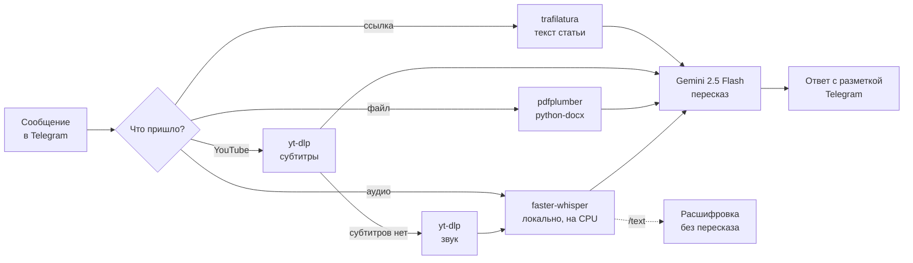

# Shorter

**Telegram-бот для шорт ревью** Присылаешь статью, PDF, видео с YouTube или голосовое на двадцать минут, а в ответ получаешь суть на русском.


---

## Что умеет

| Присылаешь | Что делает бот |
|---|---|
| Ссылку на статью | вытаскивает основной текст без меню и рекламы и пересказывает |
| YouTube-видео | берёт субтитры, а если их нет — скачивает звук и распознаёт речь |
| PDF, DOCX, TXT, MD, HTML, CSV | достаёт текст из файла и пересказывает |
| Голосовое, аудио, кружочек | распознаёт речь, присылает пересказ и кнопку «📝 Расшифровка» с полным текстом |
| Просто текст | пересказывает |

Пересказ бывает разным:

- `/brief` — три-пять предложений, только главное;
- `/detailed` — подробно, с сохранением структуры;
- `/bullets` — тезисы списком;
- `/eli5` — простыми словами.

Режим ставится перед текстом или ссылкой: `/brief https://example.com/article`.

Если нужен не пересказ, а дословный текст, есть `/text`. Его можно отправить ответом на голосовое, подписью к аудиофайлу или со ссылкой на видео с любого сайта, который понимает yt-dlp. Длинная расшифровка приходит файлом `transcript.txt`.

## Как устроено



Бот на aiogram 3 принимает сообщение и по его типу выбирает, откуда достать текст. Дальше всё сходится в одну точку: текст уходит в Gemini через OpenAI-совместимый API, а ответ в Markdown превращается в разметку Telegram и при необходимости режется на части по 4096 символов.

Речь распознаётся локально, через faster-whisper, без платных API. Бот живёт в Docker на домашнем сервере.

## Задачи, которые пришлось решить

**Пересказы обрывались на полуслове.** Gemini 2.5 — «думающая» модель, и её внутренние рассуждения тратят тот же лимит токенов, что и ответ. На длинных текстах лимит кончался раньше, чем модель доходила до пересказа. Для пересказа рассуждения не нужны, поэтому они выключены (`reasoning_effort: "none"`). Если ответ всё же упирается в лимит, бот честно дописывает «ответ обрезан» и пишет об этом в лог, а не отдаёт обрывок молча.

**Whisper падал на свежем PyAV.** Встроенный в faster-whisper декодер вызывает PyAV с аргументом, которого в новых версиях библиотеки уже нет, а готовых сборок старой версии под образ не нашлось. Вместо того чтобы закреплять старые зависимости, я написал свой декодер на ffmpeg: он превращает любой звук в 16 кГц моно, ровно то, что нужно модели.

**Тяжёлая работа не должна вешать бота.** Загрузка страниц, разбор файлов, субтитры и распознавание речи идут в отдельных потоках, чтобы бот продолжал отвечать, пока Whisper разбирает двадцатиминутное голосовое. Модель загружается один раз и дальше переиспользуется, а прогоны идут по очереди: на процессоре параллельное распознавание только мешает само себе.

**Расшифровка должна быть читаемой.** Сплошная простыня текста из голосового на 20 минут бесполезна. Поэтому текст делится на абзацы по паузам в речи и по длине, а тишина отрезается фильтром VAD.

**Субтитры YouTube на нужном языке.** yt-dlp может вернуть несколько дорожек. Бот выбирает язык самого видео, затем оригинальную английскую, затем английскую или русскую, и чистит VTT от таймкодов, тегов и повторов строк.

**Ограничения Telegram.** Боту нельзя скачивать файлы больше 20 МБ, и бот прямо об этом говорит, предлагая прислать ссылку через `/text`. Расшифровки под кнопкой хранятся в памяти (последние 100). Если бот перезапустился, кнопка честно сообщает, что текста уже нет, и подсказывает, как получить его заново.

## Стек

- **Бот:** Python 3.12 и aiogram 3, ответы размечаются через telegramify-markdown.
- **Пересказ:** Gemini 2.5 Flash через OpenAI-совместимый API, запросы идут через httpx.
- **Речь:** faster-whisper на процессоре (int8), звук декодирует ffmpeg.
- **Видео:** yt-dlp, для YouTube ему нужен deno как JS-рантайм.
- **Статьи и файлы:** trafilatura для страниц, pdfplumber и python-docx для документов.
- **Запуск:** Docker Compose.

## Запустить у себя

Нужны токен бота от [@BotFather](https://t.me/BotFather) и ключ Gemini API из [Google AI Studio](https://aistudio.google.com/apikey).

```bash
git clone https://github.com/gro225/shorterbot && cd shorterbot
cp .env.example .env        # впиши TELEGRAM_TOKEN и LLM_API_KEY
docker compose up -d --build
```

Настройки в `.env`:

| Переменная | Зачем |
|---|---|
| `TELEGRAM_TOKEN` | токен бота |
| `LLM_API_KEY` | ключ Gemini или другого OpenAI-совместимого API |
| `LLM_BASE_URL`, `LLM_MODEL` | можно подключить другую модель, по умолчанию Gemini 2.5 Flash |
| `WHISPER_MODEL` | размер модели распознавания: `base` быстрее, `small` и выше точнее |
| `ALLOWED_USERS` | Telegram ID через запятую; пусто — бот открыт всем |
| `PROXY_URL` | SOCKS5-прокси для Telegram, Gemini и yt-dlp; если не нужен, оставь пустым |

Без Docker нужен ffmpeg в системе:

```bash
python -m venv .venv && source .venv/bin/activate
pip install -r requirements.txt
python bot.py
```

`deploy.sh` выкатывает бота на свой сервер через rsync и docker-compose. Адрес сервера берётся из `deploy.local`, шаблон лежит в `deploy.local.example`.
